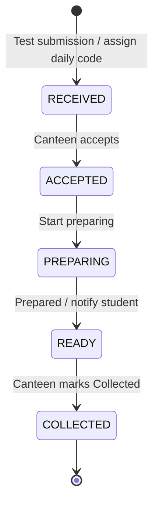

# Build BV — SpoonAte

SpoonAte is a food pre-ordering application for Banasthali Vidyapith. Students choose a canteen, add its items to a cart and submit an order. Canteen members accept orders, prepare food, notify students, and mark orders collected using the dated order details. Admins view campus-wide order activity and canteen summaries.

## Run the three websites

Install frontend workspaces from the repository root with `npm ci`, then install the backend with `npm --prefix backend ci` (or run `npm run setup` for both). Keep the existing `backend/.env`. Copy the student app `.env.example` to `.env` and configure the same Supabase project URL and publishable key as the backend. Canteen entry uses a name and member access code and needs no Supabase browser keys. The admin app uses the server-side `ADMIN_ACCESS_PASSWORD` in `backend/.env`; it does not need Supabase browser keys. Existing local frontend settings were copied to all three app environments during the split.

Install and run from the same environment: use WSL for both steps, or Windows for both. Native dependencies in `node_modules` cannot be shared between Windows and WSL. If startup reports an esbuild platform mismatch or a missing Rolldown native binding after switching environments, stop the development services and run `npm run setup` again in the terminal you intend to use. This reinstalls both dependency trees without changing environment files or database data.

Run all three websites, the API, and the notification worker together:

```bash
npm run dev
```

Run this once and keep its terminal open. Use Ctrl+C in that terminal to stop all five services before restarting. On Linux/WSL, Ctrl+Z also shuts down this project's services instead of leaving them running behind a suspended launcher. The launcher checks the required ports before starting anything; if a port is occupied, use the existing website or stop its original server first. On Linux/WSL, `ss -ltnp` shows which processes own the ports. Closing a terminal sends a hangup signal on typical Linux/WSL shells; the launcher handles that signal as well as Ctrl+C and terminates remaining child processes after a five-second grace period.

- Student: http://localhost:5173 — student login, signup and recovery.
- Canteen: http://localhost:5174 — name and member access code; the code selects the canteen.
- Admin: http://localhost:5175 — team password entry; no email, signup, verification or recovery flow.
- API: http://localhost:4000 — one shared backend/database.

Individual commands: `npm run dev:student`, `npm run dev:canteen`, `npm run dev:admin`, `npm run dev:api`, and `npm run dev:worker`. Each frontend uses a fixed port and proxies `/api` to port 4000. Set `FRONTEND_ORIGIN` (student), `CANTEEN_ORIGIN`, and `ADMIN_ORIGIN` in the backend for non-default addresses. Development defaults for canteen and admin are ports 5174 and 5175; staging/production require three distinct HTTPS origins.

For local WSL development, Windows can reach these servers through WSL's localhost forwarding. This workspace disables Cursor/VS Code automatic port forwarding, restored tunnels and forwarding when clicking terminal links, so editor tunnels cannot silently assign different portal ports. If old mappings already exist, stop the dev server with Ctrl+C, remove this project's forwarded entries in the editor's Ports panel, run Developer: Reload Window, and start `npm run dev` again. Use student port 5173, canteen port 5174 and admin port 5175. Backend origins must match those browser addresses. Remote SSH/container environments that need editor tunnels can explicitly forward the same ports through the Ports panel.

Each website has a separate route tree, build, portal-specific session and CSRF cookies, and Supabase browser storage. All three can stay signed in within the same browser. Logging in again or logging out affects only that portal. Password reset deliberately revokes all application sessions for that identity; account disabling and canteen membership/code revocation retain their existing security behavior. Existing pre-split session cookies are ignored; sign in once on each new portal. Accounts and order data are retained; no new database migration is required.

```bash
npm test
npm run lint
npm run build
npm --prefix backend test
npm --prefix backend run typecheck
npm --prefix backend run build
```

See [DEPLOYMENT.md](DEPLOYMENT.md) for builds, hosting, proxy paths and Supabase email redirect setup.

## Current implementation

The repository contains a React/Vite frontend, Express/Prisma backend and Supabase PostgreSQL. Supabase Auth handles verified email signup, student password login/reset; Express handles application sessions, server roles and canteen memberships. See [backend/AUTH.md](backend/AUTH.md) for setup and acceptance checks. Canteen categories, menus, availability and student carts now use Express and Supabase PostgreSQL. Staff manage categories/items at `/canteen/menu`; carts refresh across devices and checkout reviews signed, expiring server price quotes. Checkout now creates persistent payment-free test orders with permanent UUIDs and campus-day order references. Staff can accept, prepare and mark orders ready. Order lists/details refresh across devices; browser order records are no longer used by the app. Phase 9 now persists student notifications and read state through a leased PostgreSQL outbox worker. Collection is controlled by canteen staff through the Collected action; see [backend/PICKUP.md](backend/PICKUP.md). See [backend/NOTIFICATIONS.md](backend/NOTIFICATIONS.md) for setup, recovery and tests. Phase 11 adds database-wide admin summaries, paginated order search and audited account, membership, canteen/menu and join-code maintenance; see [backend/ADMIN.md](backend/ADMIN.md).

Menus, categories, availability and carts are saved in PostgreSQL and refresh across devices. Orders now use PostgreSQL; historical browser records are ignored. Authentication and memberships use PostgreSQL and HttpOnly cookies; the three portal sessions coexist in one browser. Different devices share scoped order lists and status updates. Prototype plaintext accounts, local role sessions and member records are removed on startup rather than imported.

Authentication code is integrated, with automated tests for server authorization and revocation. Live SMTP delivery and callback/browser acceptance remain operator checks. Production deployment, restoration and campus load qualification remain pending; the application is still for testing.

## Student signup and login

- Signup requires the student's name, an 8–256 character password and an email ending exactly in `@banasthali.in`. Enter the email OTP to activate the profile and sign in immediately. Later logins require only email/password. Configure the OTP-only Confirm sign up email template in backend/AUTH.md.
- Login requires the registered email and password. Supabase manages passwords and recovery; Express issues a hashed opaque cookie session after verifying the token and role. No student passwords are stored in browser account records or the application database.
- `@gmail.com`, subdomains, and look-alike domains are rejected. The requirement refers to the institutional email domain; a personal Gmail address is not accepted.
- Students see only their own carts, order history, and acceptance/readiness notifications.

## Banasthali canteen directory

| Canteen | ID | Current member access code |
| --- | --- | --- |
| Mukteshwari's Canteen | `mukteshwari` | `mukteshwari` |
| Shanu's Canteen | `shanu` | `shanu` |
| Spicy Bites | `spicy-bites` | `spicy-bites` |
| Annapurna Canteen | `annapurna` | `annapurna` |
| Agarwal Canteen | `agarwal` | `agarwal` |
| Fun 'N' Frolic | `fun-n-frolic` | `fun-n-frolic` |
| Desi Jayka | `desi-jayka` | `desi-jayka` |
| Bella Bite | `bella-bite` | `bella-bite` |

Names are the supplied application directory. Locations, operating hours, menus, and prices have not been confirmed with individual canteens. The connected database starts without demo menus. Staff can create categories such as Chinese and Snacks, add real items/prices and enter opening hours through Manage menu. The mockData file remains a historical test fixture and is no longer the student menu source.

Canteen staff enter **Your name** and **Member access code**. The code selects the canteen automatically and signs the member in immediately, without a dropdown, email or verification. Codes are case-insensitive. The current simple codes are listed above; apply them with `npm --prefix backend run provision:member-codes`. Re-running that command preserves matching codes and sessions. Only salted hashes are stored in PostgreSQL. Members are listed by name, and the same name within a canteen reuses its membership. Code rotation ends that canteen's sessions; removing a member blocks that name until access is restored.

## Cart and order rules

Cart additions, quantity changes, removals, totals and item counters update immediately in the current tab. A background queue saves changes in order against confirmed backend versions and keeps pending clicks visible when earlier responses arrive. Place order is enabled for valid items while saves are pending; clicking it immediately shows Submitting and blocks repeat clicks while pending saves finish and the server's latest quote is validated. Changed prices or availability require review before submission. Failed saves roll back local drafts to the last confirmed cart and show an error; uncertain writes are not automatically repeated. Pending drafts survive navigation within the app, but remain in memory until saved and are discarded by a page reload or closing the tab.

Canteen status actions update immediately and save in sequence in the background. A 400 ms guard per order ignores accidental clicks on the next status without waiting for the backend or blocking actions on other orders.

1. A student's cart contains items from exactly one canteen. Adding another canteen's food is blocked with a message; empty the cart before switching.
2. Staff can pause/resume incoming orders for their canteen and pause/enable any individual menu item. Existing orders remain available for fulfillment.
3. Item and canteen availability are checked when adding food, increasing quantity, and submitting an order. Checkout uses the current menu price rather than a stored cart price.
4. Checkout has no estimated-arrival selection. New orders use their server receipt timestamp internally; no pickup time is shown. Existing records and legacy request retries remain compatible.
5. Transactional test submission creates a permanent UUID and a three-character uppercase alphanumeric order reference on a `RECEIVED` order. Codes cannot repeat across any canteen during the same `Asia/Kolkata` calendar day, including collected orders. At campus midnight a new daily namespace becomes available without deleting history or expiring older orders. The limit is 46,656 allocations per day; exhaustion blocks new orders for that day. PostgreSQL server time determines the allocation day, and database uniqueness enforces shared concurrent allocation.
6. Order cards show the allocation day, order reference, canteen, items, quantities, value and status. Canteen order responses omit customer names, including lists, details, command replays and conflict responses. Canteen queues use placement order. Visible pickup/collection times, notification times, opening hours and countdowns are removed across all three sites; allocation dates remain to distinguish daily references.
7. Staff accept the order, start preparation, and mark it ready. The worker delivers durable acceptance/readiness notifications to the owning student. Notifications and read state persist across browsers and devices.
8. Staff buttons advance immediately through Accept order → Start preparing → Mark ready → Collected. Each order saves its actions in sequence using confirmed versions and idempotency keys; other orders stay usable. Selecting Collected shows “Order marked collected” for three seconds, then moves that card to Completed. Actual save failures restore the confirmed status and offer Retry update. No verification code is required. Only the owning canteen can collect a ready order. Collection atomically records the staff identity, time and status history; retries cannot record another handover. Queued changes survive navigation within the app; unsent steps are held in memory until saved.

The application has no order cancellation action or transition. There is no refund flow. Removing food from a cart before submission remains available. Orders do not expire automatically while awaiting collection.

## Order lifecycle



Only the owning canteen can advance its orders, one step at a time. Student and admin screens display progress without staff controls.

## Payment policy for a future release

Payment will be offered only after the canteen accepts an order. Before acceptance, the order uses an internal reference. After verified successful payment, assign the public three-character code within its reserved campus-day namespace and permit preparation. Retain the reservation day across midnight and payment retries. Accepted and paid orders have no cancellation or refund flow. No payment provider, payment screen, simulated paid state, or refund handling is part of the current test release.

## Admin

Open the separate admin website at `http://localhost:5175` and enter the team password. The password is configured privately as `ADMIN_ACCESS_PASSWORD` in `backend/.env` or the hosting secret store; never put it in frontend environment variables. There is no email, signup, OTP, activation or password-recovery flow. The backend creates the shared Admin team audit principal on its first successful sign-in, issues an isolated HttpOnly admin session and supports logout. Incorrect passwords are rate limited. No schema migration is required.

The dashboard shows canteen availability, menu counts, total and active orders, collected order value, and searchable orders with canteen/status filters. Collected order value is the sum of test order prices, not payment revenue. Account approvals, code management, and payment management are future backend work.

## Test checkout and preparation

1. Sign in at the canteen website on port 5174. Open Manage menu, create a category and add available items with real prices.
2. At the student website on port 5173 or on another device, sign up with an accessible campus email and enter the signup OTP; verification signs you in automatically. Subsequent login uses email/password.
3. Open that canteen, add items, open the cart and review checkout. Place the test order without selecting an arrival time.
4. Note its code, campus allocation day and canteen. Refresh or reopen the UUID detail link to confirm that the order persists.
5. In the owning canteen profile, accept the order, start preparation and mark it ready. The student sees the status refresh within five seconds while visible/online, or on focus/reconnect. With the worker running, acceptance/readiness notifications also persist and can be marked read.
6. If a submission cannot be confirmed, use Retry previous submission; the exact payload/key retrieves the original order.
7. Pause incoming orders and confirm that new checkout is blocked while existing orders can still be prepared.
8. In two staff profiles, try advancing the same version: only one action succeeds and the other receives a conflict.
9. When the order is READY, staff select Collected after handing over the food. Confirm that it moves to Completed on both student and canteen pages. Keep the notification worker running.

See [architecture.md](architecture.md) for implementation boundaries, data models, routes, and the future backend sequence.

See [backend/backend.md](backend/backend.md) for the step-by-step backend implementation plan, database design, API contracts, and edge-case coverage.

## Canteen members and removal

The canteen dashboard lists browser-local members who have signed in using that canteen's access code. It shows emails, members with access, distinct people with valid sessions and session counts. Sessions count until logout or 12-hour expiry; this is not live online presence. OTP delivery and cross-device counts are planned backend work.

A canteen member can remove access for a member of the same canteen after confirmation. Removal retains the membership as revoked, ends that member's canteen sessions and blocks rejoining with the shared code. Other canteens and existing order history are unaffected. Admin-only restoration is planned. These prototype controls are not server security; the backend must enforce scope, revocation, expiry and audit records transactionally.

## Planned hosting and integration

Use Supabase PostgreSQL and Auth with the TypeScript/Express/Zod/Prisma API and a separate durable outbox worker. Express enforces application authorization and business rules. API/worker and frontend hosting providers remain to be selected; AWS is an available hosting option, not a required database change.

Track integration in [todo.md](todo.md) and capacity/recovery qualification in [scale.md](scale.md). Backend Phase 1 foundation and Phase 2 schema/migrations/provisioning are implemented; see [backend setup and verification](backend/README.md). Authentication, transactional daily-code allocation, scoped synchronization and admin oversight are implemented. Live email/browser acceptance and Supabase staging/production qualification remain pending. The 30,000-user deployment remains unbenchmarked.

The product is named SpoonAte. Historical order browser records are ignored; legacy cart and availability keys are discarded; old identity keys and demo login credentials are no longer used.

Menu edits appear immediately in the staff UI and shared navigation while a background queue saves them in order. Staff can continue editing, including adding items to a category that is still saving; temporary IDs are replaced with database IDs and subsequent edits use confirmed record versions. Navigating between canteen pages preserves pending changes; reloading or closing the app before saves finish does not preserve the in-memory queue. Failed saves roll back with an error and preserve item drafts for correction. Successful writes update other open browsers through `/api/v1/<portal>/catalog/events` (server-sent events), with periodic refresh as a fallback. The student dashboard shows canteens; dishes appear inside each canteen’s menu. The event publisher currently runs within one API process; multiple API replicas need a shared event transport. Hosting must forward the event stream without buffering.
