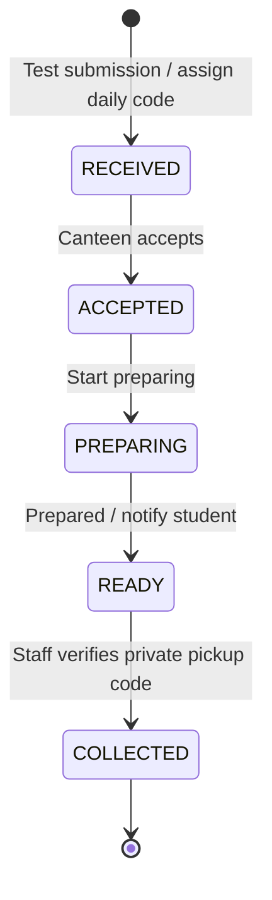

# Build BV — SpoonAte

SpoonAte is a food pre-ordering application for Banasthali Vidyapith. Students choose a canteen, add its items to a cart, select an estimated pickup time, and submit an order. Canteen members accept orders, prepare food, notify students, and verify pickup using the student’s private numeric code and dated order details. Admins view campus-wide order activity and canteen summaries.

## Run the app

Start the API in one terminal (using the configured `backend/.env`):

```bash
cd backend
npm run dev
```

Start the notification worker in another terminal (using the same backend environment):

```bash
cd backend
npm run worker:dev
```

Start the frontend in a separate terminal:

```bash
cd frontend
npm install
npm run dev
```

Open `http://localhost:5173`. Vite uses port 5173 and stops if it is occupied, so its origin stays aligned with `FRONTEND_ORIGIN` in `backend/.env`. In development, loopback addresses (`localhost`, `127.0.0.1`, `[::1]`) are also accepted on the configured protocol and port. Staging and production require the exact configured origin. If using a different frontend address, set `FRONTEND_ORIGIN` to that exact origin and restart the API. Vite's `--port` and `--strictPort` flags belong to the frontend command; the API reads `PORT` from `backend/.env` (default 4000).

Run checks from `frontend`:

```bash
npm run test
npm run lint
npm run build
```

## Current implementation

The repository contains a React/Vite frontend, Express/Prisma backend and Supabase PostgreSQL. Supabase Auth handles verified email signup, password login/reset and staff email verification; Express handles application sessions, server roles and canteen memberships. See [backend/AUTH.md](backend/AUTH.md) for setup and acceptance checks. Canteen categories, menus, availability and student carts now use Express and Supabase PostgreSQL. Staff manage categories/items at `/canteen/menu`; carts refresh across devices and checkout reviews signed, expiring server price quotes. Checkout now creates persistent payment-free test orders with permanent UUIDs and campus-day order references. Staff can accept, prepare and mark orders ready. Order lists/details refresh across devices; browser order records are no longer used by the app. Phase 9 now persists student notifications and read state through a leased PostgreSQL outbox worker. Phase 10 adds private numeric pickup verification; see [backend/PICKUP.md](backend/PICKUP.md). See [backend/NOTIFICATIONS.md](backend/NOTIFICATIONS.md) for setup, recovery and tests. Phase 11 adds database-wide admin summaries, paginated order search and audited account, membership, canteen/menu and join-code maintenance; see [backend/ADMIN.md](backend/ADMIN.md).

Menus, categories, availability and carts are saved in PostgreSQL and refresh across devices. Orders now use PostgreSQL; historical browser records are ignored. Authentication and memberships use PostgreSQL and HttpOnly cookies; different roles require separate browser profiles. Different devices share scoped order lists and status updates. Prototype plaintext accounts, local role sessions and member records are removed on startup rather than imported.

Authentication code is integrated, with automated tests for server authorization and revocation. Live SMTP delivery and callback/browser acceptance remain operator checks. Production deployment, restoration and campus load qualification remain pending; the application is still for testing.

## Student signup and login

- Signup requires the student's name, a 12–256 character password and an email ending exactly in `@banasthali.in`. Enter the email OTP to activate the profile and sign in immediately. Later logins require only email/password. Configure the OTP-only Confirm sign up email template in backend/AUTH.md.
- Login requires the registered email and password. Supabase manages passwords and recovery; Express issues a hashed opaque cookie session after verifying the token and role. No student passwords are stored in browser account records or the application database.
- `@gmail.com`, subdomains, and look-alike domains are rejected. The requirement refers to the institutional email domain; a personal Gmail address is not accepted.
- Students see only their own carts, order history, and acceptance/readiness notifications.

## Banasthali canteen directory

| Canteen | ID | Historical prototype code (unused) |
| --- | --- | --- |
| Mukteshwari's Canteen | `mukteshwari` | `Mukteshwari's Canteen` |
| Shanu's Canteen | `shanu` | `Shanu's Canteen` |
| Spicy Bites | `spicy-bites` | `Spicy Bites` |
| Annapurna Canteen | `annapurna` | `Annapurna Canteen` |
| Agarwal Canteen | `agarwal` | `Agarwal Canteen` |
| Fun 'N' Frolic | `fun-n-frolic` | `Fun 'N' Frolic` |
| Desi Jayka | `desi-jayka` | `Desi Jayka` |
| Bella Bite | `bella-bite` | `Bella Bite` |

Names are the supplied application directory. Locations, operating hours, menus, and prices have not been confirmed with individual canteens. The connected database starts without demo menus. Staff can create categories such as Chinese and Snacks, add real items/prices and enter opening hours through Manage menu. The mockData file remains a historical test fixture and is no longer the student menu source.

Canteen staff use **Join canteen** with their email, selected canteen and provisioned access code once, followed by email verification. Returning members use **Login** with email and canteen, followed by fresh email verification; the access code is only required again after rotation. The name-based codes in the directory table above are historical prototype examples and no longer work in the live login. Generated initial codes are stored privately in Git-ignored `backend/.env.provisioned`; only salted hashes are stored in PostgreSQL. Member lists/counts/removal use the authenticated Express API.

## Cart and order rules

1. A student's cart contains items from exactly one canteen. Adding another canteen's food is blocked with a message; empty the cart before switching.
2. Staff can pause/resume incoming orders for their canteen and pause/enable any individual menu item. Existing orders remain available for fulfillment.
3. Item and canteen availability are checked when adding food, increasing quantity, and submitting an order. Checkout uses the current menu price rather than a stored cart price.
4. Students select estimated pickup in 10, 20, 30, 45, or 60 minutes. The order stores an absolute pickup timestamp and a display time.
5. Transactional test submission creates a permanent UUID and a three-character uppercase alphanumeric order reference on a `RECEIVED` order. Codes cannot repeat across any canteen during the same `Asia/Kolkata` calendar day, including collected orders. At campus midnight a new daily namespace becomes available without deleting history or expiring older orders. The limit is 46,656 allocations per day; exhaustion blocks new orders for that day. PostgreSQL server time determines the allocation day, and database uniqueness enforces shared concurrent allocation.
6. Student and canteen cards show the allocation day, order reference, canteen, ordered items and quantities, pickup date/time in IST, and status. Canteen cards also show student name and order value; student history/details show order value where applicable.
7. Staff accept the order, start preparation, and mark it ready. The worker delivers durable acceptance/readiness notifications to the owning student. Notifications and read state persist across browsers and devices.
8. When staff mark an order READY, a separate random numeric pickup code (1–100) is generated and shown only to the student. Staff compare the student's name, dated order reference and items, then enter that private code against the selected order UUID. Correct verification atomically records COLLECTED, verifier/time/history and consumes the code. Five wrong guesses cause a ten-minute per-order cooldown, shared across staff; a staff-wide limit also applies. Retries cannot record another handover.

The application has no order cancellation action or transition. There is no refund flow. Removing food from a cart before submission remains available. Estimated pickup is an arrival estimate, not an automatic expiry deadline.

## Order lifecycle



Only the owning canteen can advance its orders, one step at a time. Student and admin screens display progress without staff controls.

## Payment policy for a future release

Payment will be offered only after the canteen accepts an order. Before acceptance, the order uses an internal reference. After verified successful payment, assign the public three-character code within its reserved campus-day namespace and permit preparation. Retain the reservation day across midnight and payment retries. Accepted and paid orders have no cancellation or refund flow. No payment provider, payment screen, simulated paid state, or refund handling is part of the current test release.

## Admin

Select **Admin** on the login page. For first use, select **First sign-in? Activate account**, enter the provisioned email/password from private `backend/.env.provisioned`, verify the email and return to password login. Demo credentials are no longer accepted.

The dashboard shows canteen availability, menu counts, total and active orders, collected order value, and searchable orders with canteen/status filters. Collected order value is the sum of test order prices, not payment revenue. Account approvals, code management, and payment management are future backend work.

## Test checkout and preparation

1. Sign in as a canteen in one browser profile. Open Manage menu, create a category and add available items with real prices.
2. In another browser profile or on another device, sign up with an accessible campus email and enter the signup OTP; verification signs you in automatically. Subsequent login uses email/password.
3. Open that canteen, add items, open the cart and review checkout. Choose a pickup estimate and place the test order.
4. Note its code, campus allocation day and canteen. Refresh or reopen the UUID detail link to confirm that the order persists.
5. In the owning canteen profile, accept the order, start preparation and mark it ready. The student sees the status refresh within five seconds while visible/online, or on focus/reconnect. With the worker running, acceptance/readiness notifications also persist and can be marked read.
6. If a submission cannot be confirmed, use Retry previous submission; the exact payload/key retrieves the original order.
7. Pause incoming orders and confirm that new checkout is blocked while existing orders can still be prepared.
8. In two staff profiles, try advancing the same version: only one action succeeds and the other receives a conflict.
9. When the order is READY, the student shows the private numeric pickup code. Staff verify it and confirm that the order moves to Collected. The old three-character order reference is not the handover credential. Keep the notification worker running.

See [architecture.md](architecture.md) for implementation boundaries, data models, routes, and the future backend sequence.

See [backend/backend.md](backend/backend.md) for the step-by-step backend implementation plan, database design, API contracts, and edge-case coverage.

## Canteen members and removal

The canteen dashboard lists browser-local members who have signed in using that canteen's access code. It shows emails, members with access, distinct people with valid sessions and session counts. Sessions count until logout or 12-hour expiry; this is not live online presence. OTP delivery and cross-device counts are planned backend work.

A canteen member can remove access for a member of the same canteen after confirmation. Removal retains the membership as revoked, ends that member's canteen sessions and blocks rejoining with the shared code. Other canteens and existing order history are unaffected. Admin-only restoration is planned. These prototype controls are not server security; the backend must enforce scope, revocation, expiry and audit records transactionally.

## Planned hosting and integration

Use Supabase PostgreSQL and Auth with the TypeScript/Express/Zod/Prisma API and a separate durable outbox worker. Express enforces application authorization and business rules. API/worker and frontend hosting providers remain to be selected; AWS is an available hosting option, not a required database change.

Track integration in [todo.md](todo.md) and capacity/recovery qualification in [scale.md](scale.md). Backend Phase 1 foundation and Phase 2 schema/migrations/provisioning are implemented; see [backend setup and verification](backend/README.md). Authentication, transactional daily-code allocation, scoped synchronization and admin oversight are implemented. Live email/browser acceptance and Supabase staging/production qualification remain pending. The 30,000-user deployment remains unbenchmarked.

The product is named SpoonAte. Historical order browser records are ignored; legacy cart and availability keys are discarded; old identity keys and demo login credentials are no longer used.

Menu edits appear immediately in the staff UI and shared navigation while a background queue saves them in order. Staff can continue editing, including adding items to a category that is still saving; temporary IDs are replaced with database IDs and subsequent edits use confirmed record versions. Navigating between canteen pages preserves pending changes; reloading or closing the app before saves finish does not preserve the in-memory queue. Failed saves roll back with an error and preserve item drafts for correction. Successful writes update other open browsers through `/api/v1/catalog/events` (server-sent events), with periodic refresh as a fallback. The student dashboard shows canteens; dishes appear inside each canteen’s menu. The event publisher currently runs within one API process; multiple API replicas need a shared event transport. Hosting must forward the event stream without buffering.
