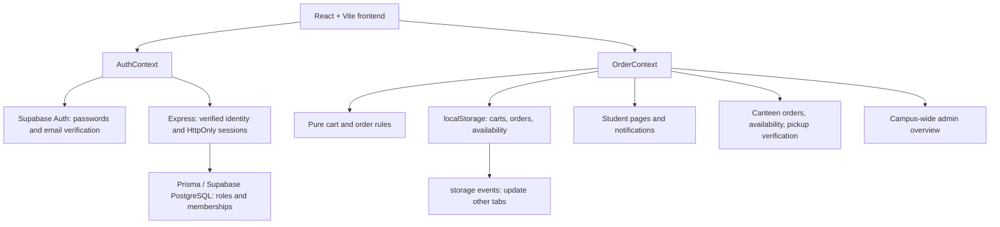
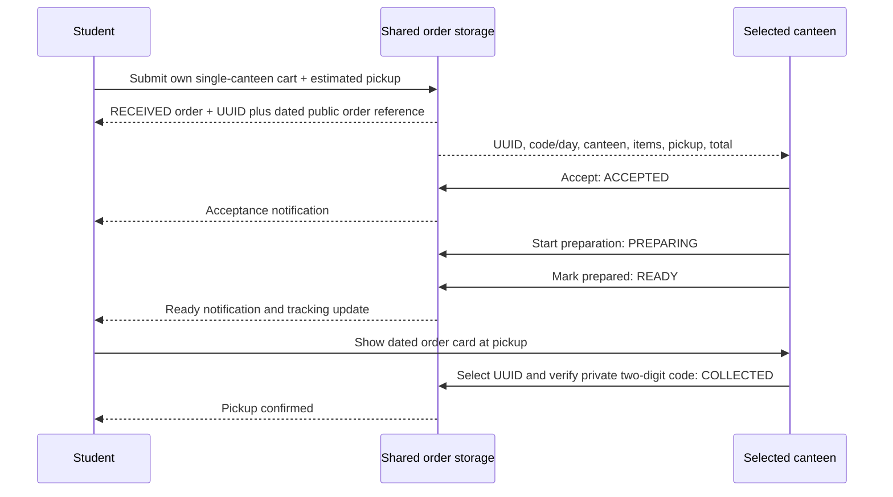
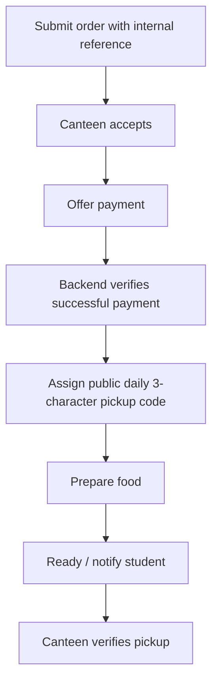

# Build BV — SpoonAte architecture

The backend implementation roadmap is in [backend/backend.md](backend/backend.md). This architecture documents Supabase Auth/Express integration and the remaining browser-storage ordering prototype. Authentication setup is in [backend/AUTH.md](backend/AUTH.md).

## Implemented system



The repository includes an Express/Prisma backend and connected Supabase database. Authentication/memberships use server authorization; order/cart/availability features remain a same-browser prototype. Transactional ordering, cross-device order delivery, production qualification and payment processing remain future work.

## Actual source structure

```text
Build_BV/
├── README.md
├── architecture.md
├── todo.md
├── scale.md
├── backend/backend.md
└── frontend/
    ├── package.json
    ├── vite.config.js
    ├── README.md
    ├── tests/orderRules.test.js
    └── src/
        ├── App.jsx
        ├── main.jsx
        ├── index.css
        ├── context/
        │   ├── AuthContext.jsx
        │   └── OrderContext.jsx
        ├── hooks/usePersistentState.js
        ├── utils/
        │   ├── authRules.js
        │   └── orderRules.js
        ├── data/
        │   ├── mockData.js
        │   └── canteenAccess.js
        └── pages/
            ├── Login.jsx
            ├── student/
            │   ├── StudentDashboard.jsx
            │   ├── CafePage.jsx
            │   ├── Cart.jsx
            │   ├── Checkout.jsx
            │   ├── OrderSuccess.jsx
            │   ├── MyOrders.jsx
            │   ├── OrderTracking.jsx
            │   ├── Notifications.jsx
            │   └── Profile.jsx
            ├── canteen/
            │   ├── CanteenDashboard.jsx
            │   ├── CanteenOrders.jsx
            │   ├── CanteenOrderDetails.jsx
            │   └── (unused screen stubs)
            └── admin/AdminDashboard.jsx
```

## Routes and ownership

| Route | Role | Behavior |
| --- | --- | --- |
| `/login` | Public | Student signup/email-password login, canteen membership login, admin login |
| `/student` | Student | Search the eight canteens and sample menus; view own active order |
| `/student/cafe/:cafeId` | Student | Browse one canteen's menu and availability |
| `/student/cart` | Student | Own single-canteen cart, quantities, removal, empty cart |
| `/student/checkout` | Student | Estimated pickup selection and test order submission |
| `/student/order-success?id=:id` | Student | Own submitted order UUID, dated public order reference |
| `/student/orders` | Student | Own active/completed orders |
| `/student/orders/:orderId` | Student | Own order progress |
| `/student/notifications` | Student | Own acceptance and readiness events |
| `/student/profile` | Student | Registered name and institutional email |
| `/canteen` | Canteen | Selected canteen's queue, acceptance, preparation, ready notification, availability, pickup, member list/removal |
| `/canteen/orders` | Canteen | Selected canteen's order history |
| `/canteen/orders/:orderId` | Canteen | Details and permitted status action for own order |
| `/admin/*` | Admin | Database-wide overview, paginated order search and audited account/membership/canteen/code maintenance |
| `/admin/canteens/:canteenId/menu` | Admin | Shared versioned category/item maintenance with audit records |

`ProtectedRoute` reads the active auth context. `OrderContext` loads student or selected-canteen orders; admin reports use a dedicated paginated feed and PostgreSQL aggregates. Express checks session, role and canteen ownership on every protected request. Admin reports do not authorize fulfillment or private pickup-code retrieval.

## Authentication

Student signup uses Supabase Auth, followed by numeric email OTP verification through Express. Successful verification activates the institutional profile and issues an app cookie session immediately; no second login is required. Subsequent password login exchanges a verified Supabase token for an Express cookie session without another OTP. Server domain validation rejects non-institutional student identities. Recovery revokes app sessions before saving the new Supabase password. Prototype plaintext account records are removed rather than imported.

Canteen login validates a salted database access-code hash, creates a challenge bound to email/canteen/code version, and requires a fresh Supabase email proof before creating the membership/session. Challenges are consumed under the canteen lock. The historical name-based browser code mapping is not imported by the login bundle.

Admin activation requires provisioned credentials and verified email. Permissions come from database roles, never client metadata. Application sessions are shared across tabs through HttpOnly cookies; use separate browser profiles for different roles. Supabase proof tokens and pending nonsecret verification context use sessionStorage; localStorage cannot establish application identity.

## Storage model

| Key | Store | Contents |
| --- | --- | --- |
| `spoonate_session` | HttpOnly cookie / PostgreSQL hash | Revocable application session, 12-hour default absolute lifetime |
| `spoonate_csrf` | HttpOnly cookie | Signed CSRF nonce matched by the request header |
| `spoonatePendingAuth` | sessionStorage | Email, flow, challenge ID/expiry and resend time; no passwords or canteen codes |
| Supabase SDK session | sessionStorage | Auth proof/refresh tokens; Express independently verifies identity on exchange |
| `campusEatsCartsV2` | localStorage | Cart item arrays keyed by student email |
| `campusEatsOrdersV2` | localStorage | All test orders |
| `campusEatsAvailabilityV2` | localStorage | `{pausedCafes: [...ids], disabledFoods: [...ids]}` |

Versioned keys avoid interpreting legacy unowned demo orders as orders from the new account system. Existing old storage is not deleted. The persistence hook subscribes to browser storage events for other tabs and a custom event for same-tab writes. Mutation callbacks read the current stored value. Checkout reads current availability and cart data before building an order.

An order stores:

- `id`: permanent UUID used for routes, mutations and notification identity. Legacy stored test orders retain their original IDs.
- `orderCode`: three uppercase alphanumeric characters, unique across all canteens within `codeDay`, including collected orders. Legacy records display their original ID as the code.
- `codeDay`: immutable allocation date (`YYYY-MM-DD`) in `Asia/Kolkata`; legacy records derive it from `createdAt`. A new namespace starts at campus midnight; history and late uncollected orders remain valid.
- `studentEmail`, `studentName`: the placing student's account.
- `cafeId`, `cafeName`: the cart's canteen.
- `items`: snapshot of food ID, name, quantity, and current menu price.
- `total`: sum of current unit prices multiplied by quantities.
- `pickupAt`: ISO timestamp chosen relative to submission; `pickupTime`: campus-time compatibility field. Order screens format `pickupAt` as a full campus date/time in IST, including older records.
- `createdAt`, `status`, `history`: creation and status change timestamps.
- `paymentStatus: NOT_REQUIRED_TEST`: no charge or simulated payment success.
- `pickupVerifiedBy`, `collectedAt`: added only after canteen verification.

`mockData.js` contains eight confirmed names and sample menus. Menu IDs are scoped to canteens. Exact locations, hours, menus, and prices await real canteen data.

## Student and canteen flow in testing



Allowed state progression is `RECEIVED → ACCEPTED → PREPARING → READY → COLLECTED`. Staff cannot skip states, reverse collection, or act for another canteen. Collection targets the permanent UUID and requires the student-only two-digit pickup code generated when the order becomes READY. The public three-character order reference is separate. PostgreSQL attempt limits, idempotency and atomic history/audit recording protect verification. Staff compare the allocation day, canteen and items on the dated student card with the selected order; code-only lookup is ambiguous across days. No cancellation, rejection/refund, or automatic expiry state is implemented. A student's estimate does not invalidate an uncollected order.

Accepted/ready events are processed by a separate PostgreSQL outbox worker into durable notifications for the owning student. Leased claims, retry backoff and a unique recipient/event/type key prevent lost or duplicate messages after worker crashes. Scoped APIs paginate notifications and persist idempotent read state. Visible/online clients poll orders and notifications every five seconds, revalidate on focus/reconnect and stop authenticated polling on session expiry. No order email or push is sent. See [backend/NOTIFICATIONS.md](backend/NOTIFICATIONS.md).

Availability is independent of order state. A canteen may pause all incoming orders or disable an individual menu item. These changes block new additions, quantity increases, and checkout; existing orders retain item snapshots and continue fulfillment. Cross-canteen cart additions are blocked without silently clearing the student's cart.

## Future backend and payment design

The future Supabase-managed PostgreSQL database, accessed by Express/Prisma, should store users, canteens, member access code hashes, menu items and availability, orders, order items, and timestamped status events. Authorized operators will manually provision canteen codes in that database. The frontend will submit canteen selection and entered code to an authenticated membership endpoint instead of importing the mapping.

Backend order creation must validate ownership, one-canteen carts, availability, quantities, prices, and pickup time in a transaction. It must atomically allocate daily codes with `UNIQUE(code_day, code)` using server time and enforce state transitions and pickup verification. Browser persistence can then be replaced with API calls and a server event or polling subscription.



Payment occurs only after acceptance. Preparation in the paid release is gated on verified payment, and the public code is assigned/exposed only after payment succeeds within an immutable reserved campus day. Preserve the reservation day across midnight/payment retries. The internal UUID remains separate from the short pickup code. No cancellation or refund flow is part of the specified product. This is a future design; the current frontend skips payment and assigns the daily code at test submission. Browser code allocation uses device time and localStorage, so cross-device/concurrent uniqueness remains a backend requirement.

## Verification

`npm run test` runs Node tests for domain validation, signup/email-password login, membership codes, all eight canteens, single-canteen carts, availability checks, current-price totals, future pickup times, daily codes/collisions/exhaustion, midnight reuse, UUID identity, campus-time display, ownership, valid transitions, pickup verification and scoped member/session revocation. `npm run lint` checks frontend sources, and `npm run build` checks the complete module graph and production bundle.

### Canteen member management

`AuthContext` reads members and counts from authenticated Express endpoints backed by PostgreSQL. Each session has a member ID and an absolute expiry. The dashboard shows own-canteen member emails, access status and valid session counts, with pagination. Counts represent signed-in sessions rather than live presence.

Confirmed removal locks the canteen and atomically revokes membership, scoped sessions and pending challenges, recording actor/time. New sign-in cannot restore access, even with the shared code, until an admin explicitly restores membership. Unrelated memberships survive. Express checks scope, account status and code version on every staff request; the UI revalidates on focus/reconnect and every 30 seconds. Admin restoration, account disabling and code-rotation APIs are audited; the dedicated maintenance UI is implemented in Phase 11; see [backend/ADMIN.md](backend/ADMIN.md).

## Plan alignment and current gaps

Supabase PostgreSQL hosts application records, Supabase Auth manages passwords/email proofs, and Express owns application roles, memberships and opaque cookie sessions. Frontend/API/worker hosting is still an implementation decision. Follow [todo.md](todo.md), [backend/AUTH.md](backend/AUTH.md) and [scale.md](scale.md) for live acceptance and the unbenchmarked campus deployment.

Authentication UI, cookie sessions, scoped member revocation and admin maintenance APIs are implemented and tested. Live SMTP/callback/browser acceptance remains pending. Ordering persistence and durable notification read state are implemented. The dedicated admin maintenance UI is implemented; standalone settings were removed, with supported details retained in Manage Menu; analytics scope and browser acceptance belong to Phase 12. The session policy currently uses absolute expiry only; idle expiry is not implemented. Existing order/cart keys remain prototype compatibility identifiers; old identity keys and demo login credentials are not used.

## Backend foundation — 2026-10-14

The repository now includes a strict TypeScript/Express API, validated server configuration, bounded JSON parsing, request IDs, redacted structured logs, error envelopes, bounded database readiness checks and shared request/response schemas for the 37 planned business operations. `GET /api/v1/canteens` reads the provisioned directory and returns only public fields. The existing Vite proxy supports `/api` development requests; the frontend still uses prototype storage.

Prisma models and the initial migration cover the planned account, membership, challenge, session, catalog, cart, order, daily allocation, notification, outbox, idempotency, audit and shared rate-limit tables. SQL adds check constraints, composite cart/canteen foreign keys, immutable history and browser-role isolation. Repeatable seeds preserve operator data. Interactive CLI commands provision salted scrypt canteen codes and admin credentials. See [backend/README.md](backend/README.md) for setup, checks and the remaining Supabase staging/production qualification.

## Phase 5–6 catalog and cart implementation

Categories, menus, availability and carts now use Express and Supabase PostgreSQL. Each item references a category within its own canteen. Menu writes serialize on the canteen; cart writes serialize on the student and lock the applicable canteen. Aggregate versions prevent lost device updates; signed expiring cart quotes reject stale price/availability reviews. Student menus use live category records, and staff manage categories/items/location/hours at /canteen/menu. Local carts and availability are discarded. Historical browser orders remain readable; new order placement awaits Phase 7. See [backend/CATALOG.md](backend/CATALOG.md) for API and verification details.

## Phase 7–8 order implementation

Orders and fulfillment now use Express/PostgreSQL rather than browser records. Checkout locks user/cart/canteen/menu/category records and atomically commits immutable snapshots, permanent campus-day code allocation, initial history/outbox, cart clearing and actor-scoped idempotency response. Staff commands lock user/canteen/order and commit consecutive status/version changes with actor/time history/outbox and stable retry responses. Scoped UUID reads feed five-second visible/online frontend polling and direct details. Pending requests persist before submission and reuse their exact payload/key after uncertain responses or refresh. See [backend/ORDERS.md](backend/ORDERS.md). Phase 9 durable notification delivery/read state is implemented; Phase 10 collection verification uses a private READY code; see [backend/PICKUP.md](backend/PICKUP.md).

## Admin reporting and maintenance

Phase 11 reports aggregate complete PostgreSQL history separately from stable, filtered order pages. Admin resources poll while visible/online and refresh after writes, focus and reconnect, retaining confirmed records during outages. Versioned maintenance writes recheck locked actors and commit audit records atomically. Account/code changes revoke applicable sessions/challenges; disabling a canteen blocks new orders and sign-ins while allowing existing staff to finish orders. History and item snapshots survive maintenance and menu deletion. See [backend/ADMIN.md](backend/ADMIN.md).

## Frontend persistence audit — 2026-10-16

Login uses the public server directory rather than the prototype canteen list. Active screens do not import the sample menu/access-code fixtures or browser-persistence hook. Catalog/cart/order UUID and paise mappings are implemented; errors do not create browser-only orders or replace failed writes with local records. Database-confirmed data survives refresh, browser storage clearing and sign-in from another browser. Unsaved drafts, in-memory queues, email proof context and uncertain-request retry keys remain browser-local. Cookie sessions are issued separately per browser; shared business data does not imply shared login. The separate notification worker must remain running to turn durable outbox events into notifications. Real browser/device acceptance and production qualification remain pending.
